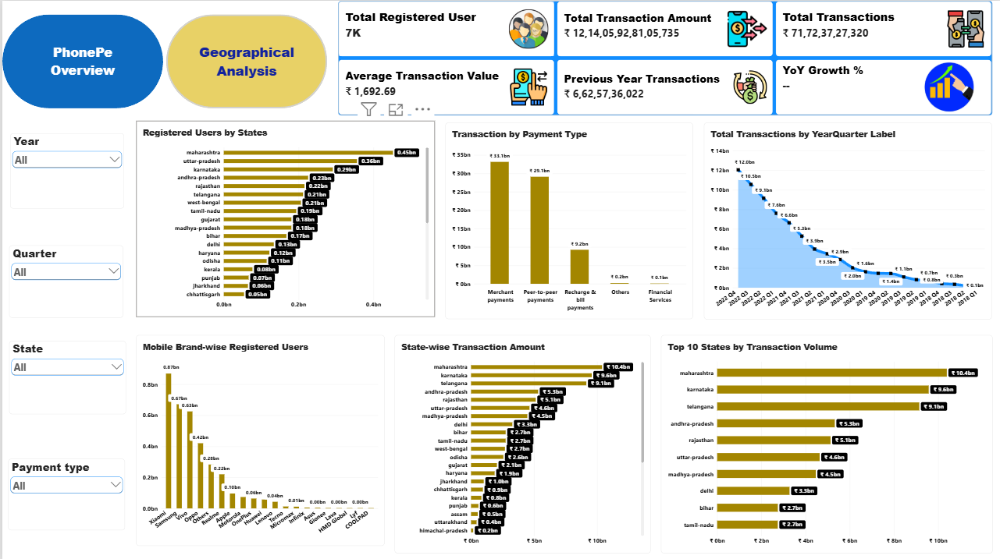
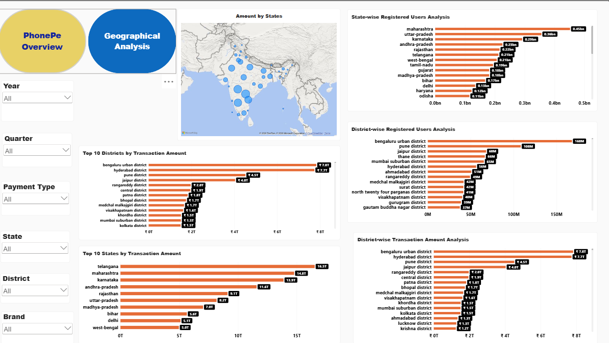

# PhonePe Pulse – Data Visualization and Exploration

## Project Overview
An interactive Power BI dashboard designed to analyze PhonePe digital payment transactions, user trends, and geographical insights across India.

## Tools & Technologies
- Microsoft Power BI
- Power Query
- DAX
- Data Visualization
- Data Cleaning and Data Modeling

## Dashboard Preview

### 1. PhonePe Overview

### 2. Geographical Analysis

## Key Features
- Transaction volume and transaction amount analysis
- Year-wise and quarter-wise transaction trends
- Payment type analysis
- State-wise and district-wise transaction analysis
- Registered user analysis
- Mobile brand usage analysis
- Interactive slicers and KPI cards
- Geographical visualization of payment activity

## Project File
The Power BI dashboard is available here:

[Download Power BI Project](phonepe_pulse_analysis.pbix)

## Project Objective
To explore digital payment trends and provide meaningful insights into transaction patterns, user adoption, and geographical distribution across India.

---

**Created as part of my Data Analytics learning and project portfolio.**
